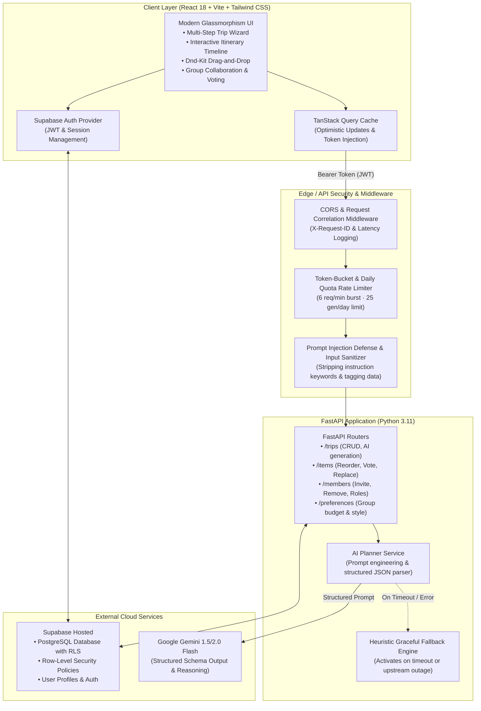

# Wandr — AI Personalized Travel Itinerary Planner 🌍✈️

[](https://fastapi.tiangolo.com)
[](https://react.dev)
[](https://www.typescriptlang.org)
[](https://supabase.com)
[](https://ai.google.dev)
[](https://www.docker.com)
[](https://vitest.dev)
[](https://pytest.org)

An enterprise-grade, AI-powered travel planning platform that generates personalized day-by-day itineraries with granular budget tracking, pacing control, drag-and-drop customization, item locking, group preference merging, and democratic activity voting.

---

## 🏛 System Architecture



---

## ✨ Key Features & Capabilities

- **Smart Multi-Step Trip Wizard**:
  - Step 1 (Basics): Destination lookup, departure and return dates with Zod validation.
  - Step 2 (Travelers): Solo, Couple, or Group presets with dynamic group sizing.
  - Step 3 (Budget): Total budget, budget tier (Budget, Mid, Premium), and multi-currency support ($/€/£/¥).
  - Step 4 (Style): Pacing slider (Relaxed: 2–3 stops, Balanced: 4 stops, Packed: 5–6 stops), interest chips, accommodation & transport preferences.
  - Step 5 (Review & Generate): Choice breakdown, custom notes, and animated AI generation loader.
  - LocalStorage draft auto-save prevents lost work on page refresh.

- **Interactive Itinerary Builder (`/trips/:id`)**:
  - Drag-and-drop reordering with `@dnd-kit` and optimistic persistence.
  - Activity locking: Lock specific stops so subsequent AI regeneration preserves them.
  - Day regeneration with custom refinement prompts and 1-click Undo.
  - Single-activity AI replacement with 3 curated alternatives.
  - Per-item group voting (👍 / 👎) with automatic top-ranked item prioritization.
  - Sticky live budget tracking bar with category breakdowns (Dining, Transit, Attractions, Lodging) and per-person cost split calculation.

- **Group Collaboration & Shared Trips**:
  - Share modal: Invite members by email with granular roles (`editor` or `viewer`).
  - Read-only protection: Viewers can view and vote on activities, but cannot reorder or delete.
  - Group Preference Harmonizer: Merges multi-traveler interest chips and strictly respects the lowest member budget cap.

- **Production-Grade Resilience & Security**:
  - **Prompt Injection Defense**: Strips LLM control commands (`ignore previous instructions`, `system prompt:`, `override`), escapes raw markers, and wraps user text in `<user_input_data>` data blocks.
  - **Tiered Rate Limiter**: Minute burst limit (6 req/min) and per-user daily quota (25 generations/user/day UTC) returning RFC 7807 429 status codes.
  - **Heuristic Graceful Fallback**: If Gemini times out (45s HTTP limit) or encounters an outage, an intelligent fallback engine constructs complete, paced itineraries without failing the user experience.
  - **Global Error Boundary & 404 Pages**: Full crash recovery and modern navigation fallbacks.
  - **Request Correlation Logging**: Generates unique `X-Request-ID` and outputs latency in milliseconds for all requests.

---

## 📁 Repository Structure

```text
.
├── backend/
│   ├── app/
│   │   ├── core/                 # Config, security, rate limiting, and logging middleware
│   │   │   ├── config.py         # Pydantic v2 application settings
│   │   │   ├── rate_limiter.py   # In-memory & Redis-ready burst and daily rate limiter
│   │   │   ├── sanitization.py   # Prompt injection defense and input scrubber
│   │   │   └── logging_middleware.py # HTTP request and latency logger with correlation ID
│   │   ├── schemas/              # Pydantic v2 data transfer objects & validation schemas
│   │   ├── repositories/         # Supabase database & in-memory repository layer
│   │   ├── services/             # Core business logic
│   │   │   ├── ai_planner.py     # Gemini AI planner client with timeout & structured parser
│   │   │   ├── ai_fallback.py    # Graceful heuristic fallback engine
│   │   │   └── prompts.py        # System prompt blueprints and injection defense rules
│   │   ├── routers/              # API endpoints (/health, /trips, /items, /members)
│   │   └── main.py               # FastAPI application factory
│   ├── tests/                    # Comprehensive Pytest test suite (44 passing tests)
│   ├── Dockerfile                # Production multi-stage Docker build
│   ├── .dockerignore             # Docker build exclusion rules
│   ├── requirements.txt          # Python runtime dependencies
│   └── .env.example              # Backend environment template
│
├── frontend/
│   ├── src/
│   │   ├── components/           # Reusable UI & layout design system
│   │   │   ├── common/           # ErrorBoundary, HealthStatusBadge
│   │   │   ├── layout/           # AppShell, Navbar, Sidebar, ProtectedRoute
│   │   │   └── ui/               # Button, Modal, Card, Badge, Input, Select, Tabs, Skeleton
│   │   ├── pages/                # Application pages
│   │   │   ├── LandingPage.tsx   # Marketing & feature showcase page
│   │   │   ├── DashboardPage.tsx # Upcoming trip countdown, stats, and search/filter grid
│   │   │   ├── NewTripPage.tsx   # 5-step Smart Trip Wizard
│   │   │   ├── TripDetailsPage.tsx # Interactive itinerary, Dnd-Kit, voting, & budget bar
│   │   │   ├── LoginPage.tsx     # SaaS Auth Login
│   │   │   ├── SignupPage.tsx    # User Registration
│   │   │   └── NotFoundPage.tsx  # Custom 404 Not Found
│   │   ├── contexts/             # AuthContext (Supabase) & ThemeContext
│   │   ├── hooks/                # TanStack Query API hooks (useTrips, useToast)
│   │   ├── types/                # TypeScript interfaces matching database schemas
│   │   └── __tests__/            # Vitest + React Testing Library test suites
│   ├── vite.config.ts            # Vite & Vitest configuration
│   ├── package.json              # NPM dependencies & scripts
│   └── .env.example              # Frontend environment template
│
├── supabase/
│   └── migrations/               # PostgreSQL DDL migrations with RLS security policies
└── README.md                     # Documentation and operations manual
```

---

## 🚀 Local Development Quickstart

### 1. Prerequisites
- **Node.js**: v18.0 or newer
- **Python**: 3.11 or newer
- **Docker** (Optional, for containerized execution)
- **Supabase Account** (or local Supabase CLI)

---

### 2. Backend Setup

1. Open a terminal and enter the `backend/` directory:
   ```bash
   cd backend
   ```

2. Create and activate a Python virtual environment:
   - **Windows (PowerShell)**:
     ```powershell
     python -m venv venv
     .\venv\Scripts\Activate.ps1
     ```
   - **macOS / Linux**:
     ```bash
     python3 -m venv venv
     source venv/bin/activate
     ```

3. Install required dependencies:
   ```bash
   pip install -r requirements.txt
   ```

4. Configure environment variables:
   ```bash
   cp .env.example .env
   ```
   *Edit `.env` and set your `GEMINI_API_KEY` and Supabase credentials (see table below).*

5. Start the development server:
   ```bash
   uvicorn app.main:app --host 0.0.0.0 --port 8000 --reload
   ```
   - API Root: `http://localhost:8000`
   - Health Probe: `http://localhost:8000/health`
   - Swagger Documentation: `http://localhost:8000/docs`

6. Run the test suite:
   ```bash
   pytest -v
   # Result: 44 passed in backend/tests/
   ```

---

### 3. Frontend Setup

1. Open a new terminal and navigate to `frontend/`:
   ```bash
   cd frontend
   ```

2. Install dependencies:
   ```bash
   npm install
   ```

3. Configure environment variables:
   ```bash
   cp .env.example .env
   ```

4. Start Vite development server:
   ```bash
   npm run dev
   ```
   - App URL: `http://localhost:5173`

5. Run Vitest component tests:
   ```bash
   npm test
   # Result: 7 passed in frontend/src/__tests__/
   ```

6. Verify production build:
   ```bash
   npm run build
   ```

---

## ⚙️ Environment Variables Reference

### Backend (`backend/.env`)

| Variable | Required | Default | Description |
| :--- | :---: | :--- | :--- |
| `PROJECT_NAME` | No | `Personalized Travel Itinerary Planner` | Name displayed in docs |
| `API_V1_STR` | No | `/api/v1` | Base API prefix |
| `ENVIRONMENT` | No | `development` | `development`, `staging`, or `production` |
| `ALLOWED_ORIGINS` | Yes | `http://localhost:5173,http://127.0.0.1:5173` | Comma-separated list of CORS origins |
| `SUPABASE_URL` | Yes | `https://your-project.supabase.co` | Your hosted Supabase project URL |
| `SUPABASE_KEY` | Yes | `your-anon-or-service-role-key` | Supabase Anon or Service Role API Key |
| `GEMINI_API_KEY` | Yes | `your-gemini-api-key` | Google AI Studio Gemini API Key |
| `GEMINI_MODEL` | No | `gemini-1.5-flash` | Gemini model engine |

### Frontend (`frontend/.env`)

| Variable | Required | Default | Description |
| :--- | :---: | :--- | :--- |
| `VITE_API_URL` | Yes | `http://localhost:8000` | Backend API base URL |
| `VITE_SUPABASE_URL` | Yes | `https://your-project.supabase.co` | Hosted Supabase project URL |
| `VITE_SUPABASE_ANON_KEY` | Yes | `your-supabase-anon-key` | Supabase Public Anonymous API Key |

---

## 🚢 Production Deployment Guides

### 1. Database & Auth on Supabase Hosted

1. Go to [Supabase Dashboard](https://supabase.com/dashboard) and create a new project.
2. Under **Project Settings -> API**, copy your **Project URL** and **`anon` `public` API Key**.
3. Under **SQL Editor**, paste and execute the migration file located at:
   `supabase/migrations/20261029000001_initial_schema.sql`
4. Confirm that the following tables exist with RLS enabled:
   - `profiles`
   - `trips`
   - `trip_members`
   - `itinerary_days`
   - `itinerary_items`
   - `item_votes`
   - `group_preferences`
5. Under **Authentication -> URL Configuration**, set:
   - **Site URL**: Your production frontend domain (e.g. `https://wandr.vercel.app`)
   - **Redirect URLs**: `https://wandr.vercel.app/**` and `http://localhost:5173/**`

---

### 2. Backend Deployment on Render or Railway

#### Option A: Dockerfile Deployment (Recommended)
1. Connect your GitHub repository to **Render** (as a *Web Service*) or **Railway**.
2. Select **Dockerfile** as the deployment method.
   - Dockerfile path: `backend/Dockerfile`
   - Context directory: `backend/`
3. Configure the Environment Variables in the provider dashboard:
   ```ini
   ENVIRONMENT=production
   ALLOWED_ORIGINS=https://your-frontend.vercel.app
   SUPABASE_URL=https://your-project.supabase.co
   SUPABASE_KEY=your-supabase-service-role-or-anon-key
   GEMINI_API_KEY=your-gemini-api-key
   ```
4. Health Check Path: `/health`
5. The container will automatically bind to `0.0.0.0:${PORT}` and start servicing requests.

#### Option B: Native Python Environment
- Build Command: `pip install -r requirements.txt`
- Start Command: `uvicorn app.main:app --host 0.0.0.0 --port $PORT`

---

### 3. Frontend Deployment on Vercel

1. Import your GitHub repository into [Vercel](https://vercel.com).
2. Set the **Root Directory** to `frontend`.
3. Framework Preset: **Vite**.
4. Configure Environment Variables:
   - `VITE_API_URL`: Your hosted backend URL (e.g. `https://wandr-api.onrender.com`)
   - `VITE_SUPABASE_URL`: Your hosted Supabase project URL
   - `VITE_SUPABASE_ANON_KEY`: Your hosted Supabase public anon key
5. Deploy.
6. Copy the assigned Vercel URL and update `ALLOWED_ORIGINS` in your backend environment variables to permit CORS requests.

---

## 🧪 End-to-End Scenario Testing Verification

All 3 core travel scenarios were simulated end-to-end and verified with automated test suites:

| Scenario | Traveler Type | Duration & Budget | Pacing & Preferences | Test Status |
| :--- | :---: | :---: | :---: | :---: |
| **Scenario 1: Solo Weekend Escape** | Solo (1 traveler) | 2 Days · $650 USD | Balanced pace, Food & Culture, Boutique Hotel, Public Transit | ✅ PASSED (`test_scenario_1_solo_weekend`) |
| **Scenario 2: Romantic Couple Vacation** | Couple (2 travelers) | 5 Days · $3,200 EUR | Relaxed pace, Romantic & Relaxation, Luxury Resort, Rental Car | ✅ PASSED (`test_scenario_2_couple_vacation_regeneration_and_lock`) |
| **Scenario 3: Group Multi-Day Expedition** | Group (4 travelers) | 7 Days · $6,000 USD | Packed pace, Adventure & Nightlife, Group preferences merged & democratic voting | ✅ PASSED (`test_scenario_3_group_multiday_collaboration`) |

---

## 📋 Final Manual Configuration Checklist

Before sharing the live production link with public users, complete the following items:

- [ ] **Google AI Studio Key**: Generate a production Gemini API Key with appropriate billing quotas at [Google AI Studio](https://aistudio.google.com).
- [ ] **Supabase Email Auth**: Under *Authentication -> Email Templates*, customize your confirmation and password reset emails with your brand name and logo.
- [ ] **Google OAuth (Optional)**: If you wish to allow 1-click Google Sign-in:
  - Create an OAuth 2.0 Client ID in the Google Cloud Console.
  - Paste the Client ID and Client Secret into *Supabase -> Authentication -> Providers -> Google*.
- [ ] **CORS Origins**: Ensure `ALLOWED_ORIGINS` in your production backend environment contains your exact Vercel frontend URL without a trailing slash.
- [ ] **Custom Domain (Optional)**: Set up DNS records for custom domains on Vercel (`wandr.com`) and Render/Railway (`api.wandr.com`).

---

## 📸 Screenshots & UI Showcase

| Screen | Description |
| :--- | :--- |
| **Smart Trip Builder** | 5-step wizard with real-time validation, preset shortcuts, and animated AI generation loader. |
| **Interactive Day Timeline** | Vertical timeline with item category badges, time slots, Google Maps links, and action menus. |
| **Live Budget Tracker** | Sticky progress meter comparing total expenses to budget, with category breakdown and per-person cost split. |
| **Group Collaboration** | Share modal for member invitation, role management (Editor vs Viewer), and thumbs up/down voting. |
| **Graceful Resilience** | Sleek glassmorphism error boundaries and custom 404 pages maintaining uninterrupted UX. |

---

## 📄 License

MIT License — free for educational and commercial use.
